# ICHI 一奇抽赏助手

**拍照识别抽赏版面，附近好版有迹可循。**

**微信搜索「ICHI 一奇抽赏助手」即可使用。** V2.0 已上线，包含好版地图。

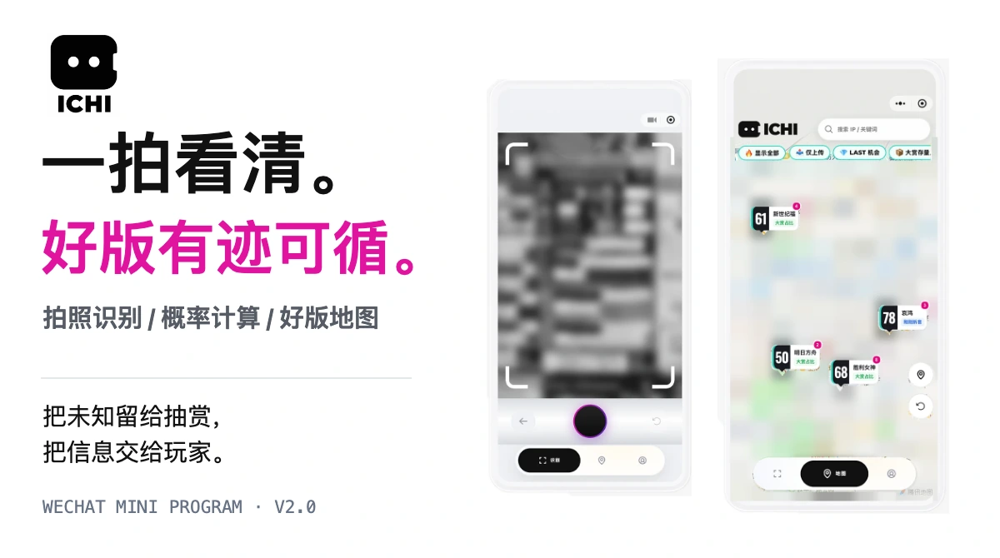

ICHI 是面向抽赏玩家的微信小程序：拍摄现场版面，核对各赏级余票，查看概率并记录每次抽取；出发前，也能从好版地图发现附近值得关注的版面。

[最短上手](#开始使用) · [功能展示](#从一张照片到一次抽赏) · [技术思路](#模型负责看见代码负责算清) · [本地开发](#本地开发与验证)

<!-- 地图分享合同
当前地图分享约束：UPLOAD_CONFIRMATION_MAP_SHARING_V2。
原上传确认即分享意愿；核验后进入V1（不依赖条例），同意条例后通过V1→V2准入门。
V2已准入数据自动生成Marker，不设二次审核或授权。
当前条例覆盖本人此前及以后已上传V1记录。
本人记录只显示V1“已上传”，禁止二次分享按钮。
现行规范：docs/decisions/map-upload-sharing-contract.md。
-->

## 把未知留给抽赏，把信息交给玩家

到店前，往往不知道目标版面还剩什么；到了现场，还要数票、核对余奖、手算机会。零散分享也可能已经过时。

ICHI 把拍照识别、概率计算和地图线索接在一起，让玩家看清当前余票、了解每一抽的机会，也更容易找到下一站。


## 从一张照片，到一次抽赏

### 拍照 → 核对 → 看清余票

拍摄或导入抽赏版面，核对识别结果，再设定关注的大赏。各赏级余票与概率放在同一个界面；每记录一抽，剩余状态随之更新。

<p>
  
  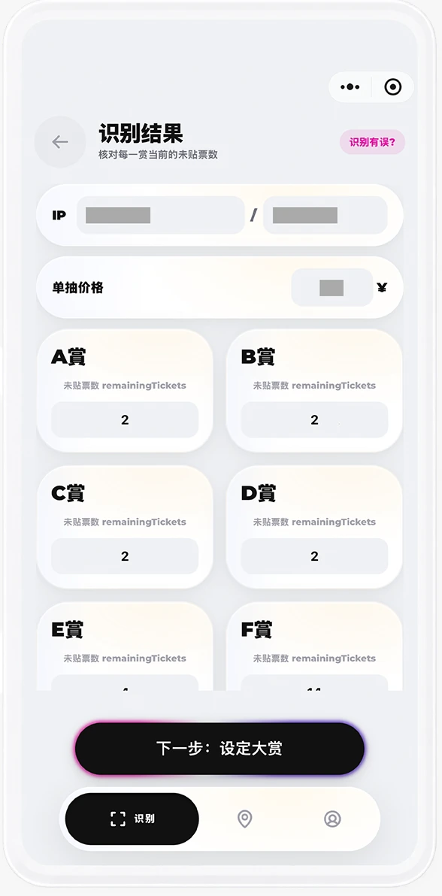
  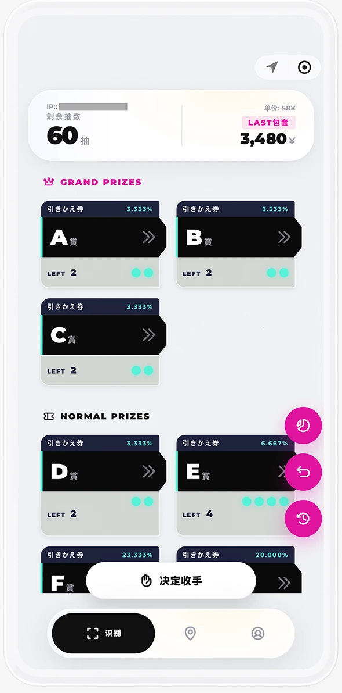
</p>

### 好版地图：先发现，再去现场

查看附近版面，用 IP / 关键词检索，按状态标签寻找线索。点开 Marker 看余票、详情与来源；点位重叠时，通过列表选择具体版面。

<p>
  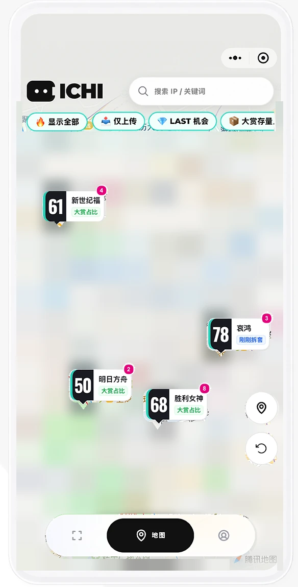
  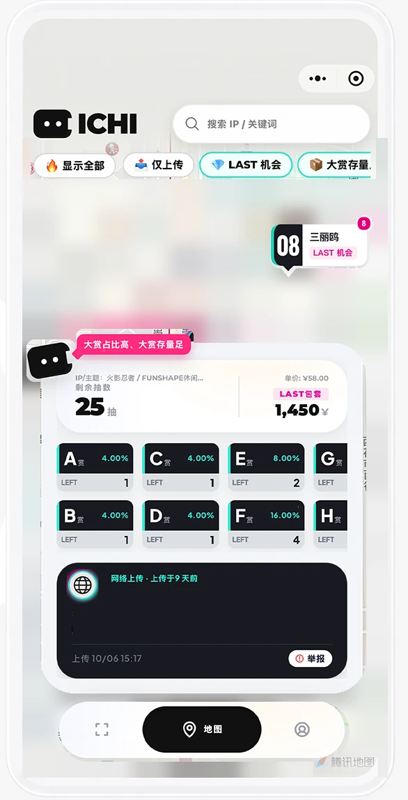
  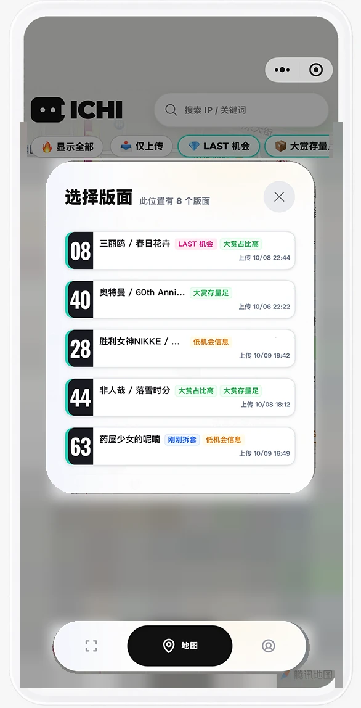
</p>

地图汇集玩家上传与标明来源的网络线索。结合来源、现场记录时间和上传时间，选择值得到店核实的版面。

### 观察窗口与记录：每一抽，都有上下文

观察窗口按当前余票计算接下来几抽的可能情况；抽取记录保留已发生的操作，上传记录显示相应处理状态，便于之后查看。

<p>
  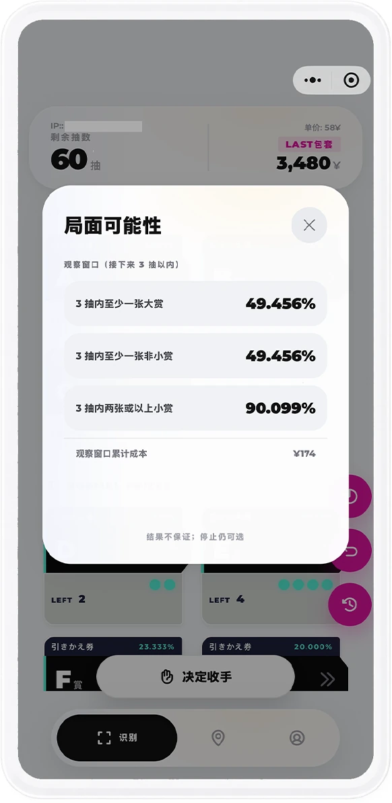
  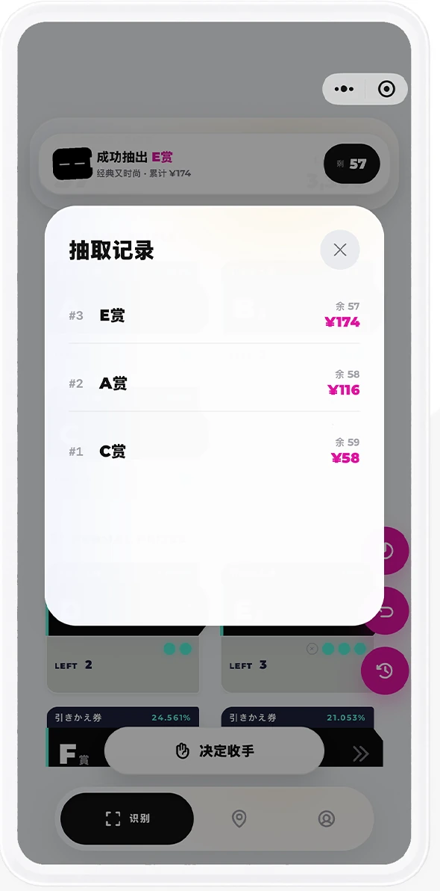
  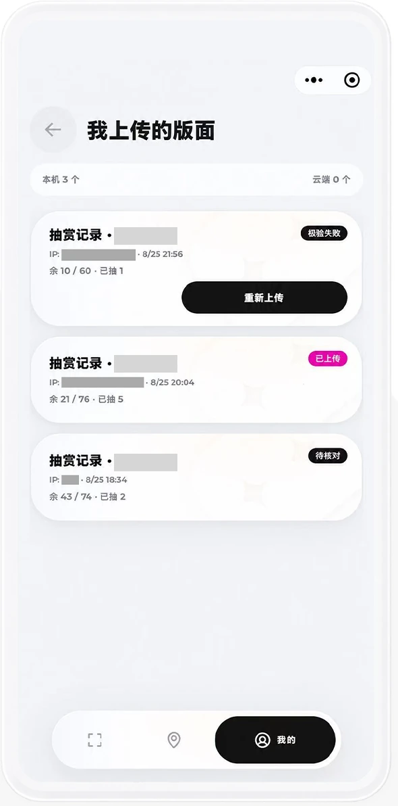
</p>

## 开始使用

1. 在微信搜索 **「ICHI 一奇抽赏助手」**，或识别下方小程序码。
2. 进入「识别」，拍摄或导入现场抽赏版面，**核对识别结果**，设定大赏。
3. 查看余票与概率，记录每次抽取，通过观察窗口查看变化。
4. 打开好版地图，搜索附近版面，查看标签、来源、时间、备注与详情。


愿意贡献现场信息时，确认上传并完成核验，记录会保存到个人云端。账号同意地图贡献条例后，符合公开规则的记录由后台自动转入地图。[了解分享规则](docs/decisions/map-upload-sharing-contract.md)。

## 模型负责看见，代码负责算清

### 01 / REMAIN：只识别必要的余票

从 HYBRID 的全量判断转向 REMAIN：减少对已贴票与整版总量的重复还原，优先提取可见余票。当前 R2 路线由 `qwen3.7-flash` 输出视觉信息，代码解析、校验并归一；用户核对后，概率与抽赏辅助由本机确定性计算生成。

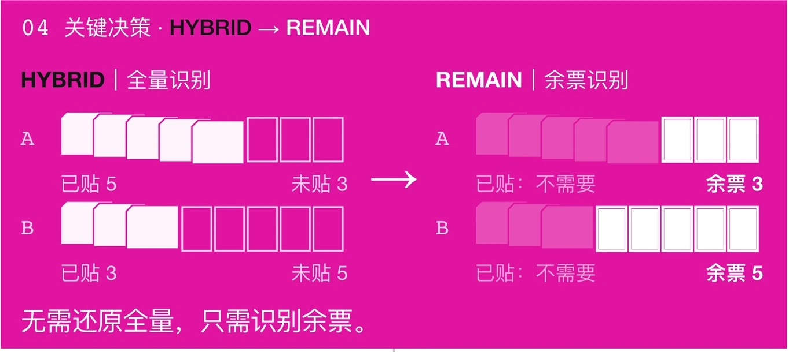

### 02 / 前进继承与受控共享

系统结合位置、IP、版面结构与余票变化判断同一版面，关联唯一匹配的记录，保留歧义待确认。版面关联与地图准入分别处理。

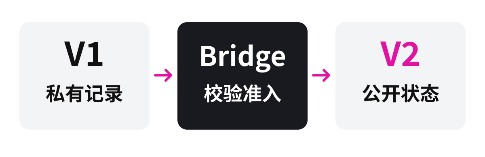

上传确认表达分享意愿，核验完成后保存为 **V1 私有记录**。账号同意当前条例后，**Bridge** 按位置、安全与有效性规则完成准入，生成 **V2 地图状态**。条例覆盖本人此前及以后已上传的合格记录，更新、删除与撤回同步到地图。

### 03 / Canvas PNG 与原生地图

Canvas 将 Marker 绘制为 PNG，按内容缓存，再交给微信原生地图的 `iconPath`。缩放改变可见密度，邻近点位按视图聚合，重叠版面可逐个查看。


**黑色数字表示代表版面的剩余抽数，玫红角标表示聚合成员数。**

<details>
<summary>500 Marker 密集渲染测试</summary>

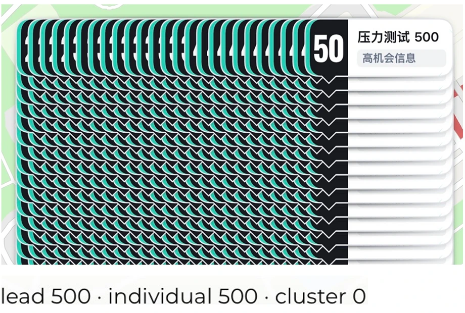

同屏密集 Marker 场景的渲染验证。[查看测试记录](docs/delivery/v2-d-task-18-true-device-marker-stress-result.md)。

</details>

## 架构与技术栈

产品运行在微信原生小程序。识别与持久化交给云服务，概率、记录与地图规则使用独立领域模块；Next.js 网页用于设计与流程验证。

| 层 | 实际采用 |
| --- | --- |
| UI / UX 设计 | Figma，设计与原型 |
| 产品客户端 | 微信原生小程序、TypeScript、WXML / WXSS |
| 网页验证 | Next.js 15、React 19 |
| 领域与状态 | TypeScript 独立模块、确定性计算、记录状态机 |
| 后端与存储 | 腾讯云 CloudBase、云函数、文档数据库、对象存储 |
| 图像理解 | 阿里云百炼、`qwen3.7-flash` |
| 数据约束 | JSON Schema、AJV、版本化契约 |
| 工程验证 | pnpm workspace、Vitest、Playwright、ESLint、GitHub Actions |

实现分工见[仓库架构](memory-bank/architecture.md)，平台与依赖见[技术栈](memory-bank/tech-stack.md)。

## 本地开发与验证

需要 **Node.js ≥24.11.0 且 <25**，**pnpm 11.9.0**。使用锁定依赖：

```bash
corepack pnpm install --frozen-lockfile
corepack pnpm --filter @ichi/web dev
```

- `apps/web/`：Next.js 网页原型与流程验证。
- `apps/client/miniprogram/`：微信原生客户端。在微信开发者工具中导入仓库根目录，使用 `project.config.json` 指定的客户端目录与 TypeScript 编译设置。
- `services/cloudbase/`、`packages/v2-map/`：识别、私有记录与地图后端，使用 CloudBase 配置云资源、身份与服务端环境。

参考 [`recognize-board/.env.example`](services/cloudbase/functions/recognize-board/.env.example)，配置 `DASHSCOPE_API_KEY`、`DASHSCOPE_WORKSPACE_ID`、`DASHSCOPE_REGION`、`DASHSCOPE_MODEL` 等云函数环境变量。配置方法见 [CloudBase 说明](services/cloudbase/README.md)。

常用检查：

```bash
corepack pnpm test
corepack pnpm typecheck
corepack pnpm lint
corepack pnpm validate:contracts
corepack pnpm --filter @ichi/web build
corepack pnpm test:web
```

图片证据测试还需要 [`requirements-test.txt`](requirements-test.txt) 固定的 `Pillow==12.3.0`，并设置 `ICHI_IMAGE_DECODER_PYTHON` 为安装了该依赖的 Python **绝对路径**。完整质量门为 `corepack pnpm quality`；配置示例见 [CI 工作流](.github/workflows/quality.yml)。

### 版本状态

线上版本：**2.0.0**。开发版本：**2.0.1**，包含系统体验草稿与默认地图主页。V2-E 已归档，**当前活动区块：无**。发布与开发记录见[版本归档](docs/delivery/v2.0.0-closeout-and-v2.0.1-github-merge.md)。

## 文档与许可

- [产品总览](PRD.md) · [正式产品设计](memory-bank/design-document.md)
- [当前进度](memory-bank/progress.md) · [实施计划](memory-bank/implementation-plan.md)
- [地图上传与分享规则](docs/decisions/map-upload-sharing-contract.md)
- [客户端说明](apps/client/README.md) · [CloudBase 说明](services/cloudbase/README.md)
- [README 素材来源与制作说明](docs/readme-redesign/asset-plan.md)
- [Agent 执行纪律](AGENTS.md)

产品设计、技术实现与开发进度维护于 `memory-bank/`。

项目级许可证尚未指定。第三方字形许可见 [Marker 字体许可](apps/client/miniprogram/pages/home/marker-font.LICENSE.txt)。
